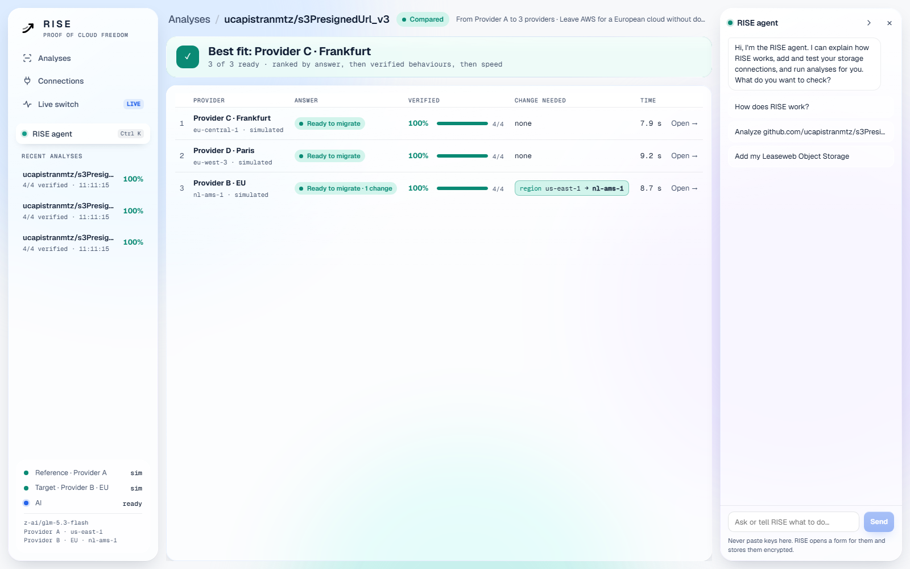
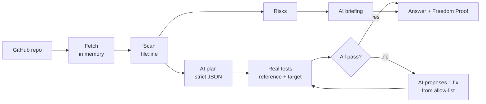
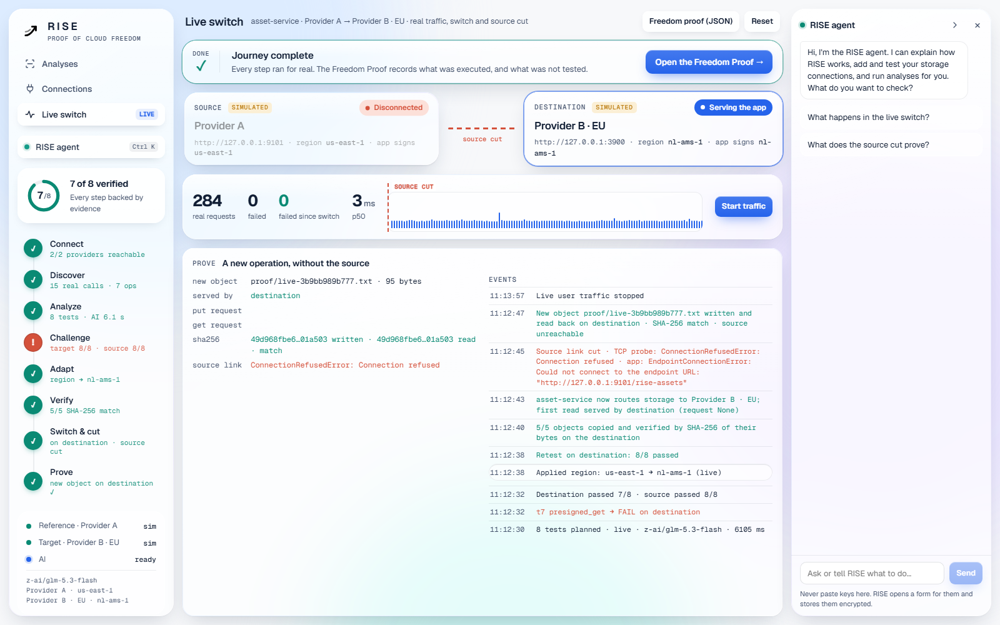
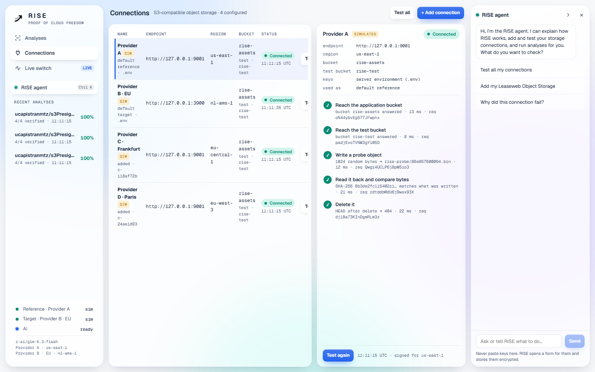

<p align="center">
  
</p>

<h1 align="center">RISE</h1>

<p align="center"><b>The Proof of Cloud Freedom. Prove your cloud migration before you move.</b></p>

<p align="center">
Paste a GitHub repository. RISE finds every object-storage call in the code, has an AI plan the tests, runs them for real on the clouds you pick, and gives you one answer: <b>ready to migrate, or not</b>, with the evidence.
</p>

<p align="center">
  
  
  
  
  
  
</p>

<p align="center">
  <a href="#quick-start"><b>Quick start</b></a> ·
  <a href="#how-it-works">How it works</a> ·
  <a href="#deploy">Deploy</a> ·
  <a href="#security">Security</a> ·
  <a href="#honest-limits">Limits</a>
</p>

<p align="center">
  
</p>

---

## Why

In the Leaseweb Digital Independence Survey 2026 (800 senior leaders in the UK, US, DE and NL, published 4 Nov 2026):

| | |
|---|---|
| **89%** | could not move business-critical workloads off their largest provider within three weeks |
| **79%** | expect AI to increase their dependence on a few providers |

These are survey answers, not measured migrations. Even "S3-compatible" providers differ in behaviour and configuration. Teams need **evidence**, not assumptions. RISE produces it in seconds.

## Three questions, one answer

<p align="center"></p>

1. **Which repository?** Public, or private with a read-only GitHub token (used once for the download, never stored).
2. **What do you want to do?** Optional, in your own words or with one click: *move to another cloud*, *add a backup provider*, *find lock-in and single points of failure*, *pick the best provider*.
3. **From which provider to which?** Pick one target, or up to four to **compare** them.

<p align="center"></p>

The answer comes first: **Ready to migrate**, **Ready · 1 change**, **Partially verified** or **Not ready**. It is decided by code from the real test results, never by the AI. Below it:

- **What RISE sees:** an AI briefing in plain words, in your language, with the next 2–4 steps.
- **Risks** with a clickable `file:line`: single point of failure, region or AWS addresses written in the code, cloud keys in the code (redacted), provider-only features (SSE-KMS, Glacier, Object Lock…), public ACLs, no timeouts or retries, other cloud services (SQS, DynamoDB, Lambda…).
- **Every test** on both providers, side by side, with request IDs and timings.
- **The Freedom Proof:** a downloadable JSON report with a SHA-256 digest.

<p align="center"></p>

**Compare** runs the same code and the same tests on every target **in parallel** and ranks them by answer, verified behaviours, then speed: **Best fit: X**.

## Features

| | |
|---|---|
| 🔎 **Code scan** | Finds every S3 call site and behaviour in boto3, AWS SDK JS v2/v3, Go, Java and PHP: metadata, ranges, presigned URLs, multipart, tags, SSE, ACLs, storage classes, the signing region. Each finding links to `file:line`. |
| 🧠 **AI test plan** | An LLM turns the code evidence into a test plan in **strict JSON schema**. RISE validates it, drops unknown tests, clamps parameters and adds anything the AI missed. |
| ⚡ **Real tests** | 13 test kinds run against the reference and the target **at the same time**, with synthetic data. A test passes only if checks on the **real bytes** pass (SHA-256, never ETags). |
| 🛠 **Auto-adapt** | When something fails, the AI may propose **one** change from an allow-list (`region`, `addressing_style`). RISE applies it and retests everything. |
| 🧭 **Risk radar** | Deterministic rules find architecture risks, single points of failure included, with `file:line` evidence. The AI explains them; it never invents them. |
| ⚖️ **Compare clouds** | Up to 4 targets in parallel, ranked, with the exact change each one needs. |
| 🔒 **Private repos** | A read-only GitHub token, used for the download only: never stored, logged or sent to the AI. |
| 🔌 **Any S3 provider** | Add Leaseweb Object Storage, AWS S3, MinIO… from the UI. Keys are encrypted at rest. **Test** makes real calls and explains failures (wrong region, rejected key, missing bucket). |
| 💬 **RISE agent** (`Ctrl K`) | Ask "can we migrate?" and get the answer with the file to change. It can also start analyses and comparisons, test connections and open pages. |
| 🔁 **Live switch** | The full journey on a running app: discover → test → adapt → copy and verify → switch → cut the old cloud → prove a new write works. |

## How it works



| Stage | What really happens |
|---|---|
| **Fetch** | The repository archive is downloaded into memory. Only text source files are read. Nothing is written to disk or executed. |
| **Scan** | Deterministic rules, no AI. Every call site and behaviour, plus the other cloud services the code depends on. |
| **AI plan + briefing** | Two AI calls run in parallel: the test plan, and a plain-words briefing for your goal. If the AI is down: the last valid plan, labelled **CACHED**, or a rule-based one, labelled **RULES**. |
| **Real tests** | The plan runs on both providers in a thread pool, using the region the code actually signs with. |
| **Adapt** | At most one allowed config change per failure, then a full retest. |
| **Report** | The answer, a portability score, failures, unsupported features, **untested** items, lock-in, and the proof (`/api/analyses/{id}/proof`). |

**Speed.** A 10-file TypeScript repository took **11.3 s** from URL to proof (fetch 1.2 s, scan 22 ms, AI plan 9.0 s, 8 real S3 tests 1.1 s). Simple repositories finish in about **6 s**. A three-provider comparison took about **16 s**.

### The live switch (`/demo`)

`CONNECT → DISCOVER → ANALYZE → CHALLENGE → ADAPT → VERIFY → SWITCH → CUT → PROVE`

RISE instruments a running app (`asset-service`) and records each real S3 call. It tests the destination, applies one fix, copies the objects and checks the **SHA-256 of the bytes**. Then it switches the app's storage route, which is refused until the evidence passes. It closes the network link to the old provider (TCP refused, reversible). Finally, the app writes and reads a brand-new object on the new one. A request every 300 ms is plotted live by provider and latency, so the audience sees the switch happen. In our runs the failures after the switch were **0**.

<p align="center"></p>

## Quick start

### Docker (one command)

```bash
git clone https://github.com/franciscogfsm/Rise.git && cd Rise
OPENROUTER_API_KEY=sk-or-... docker compose up --build
```

Open **http://localhost:8080**. The container runs RISE plus two simulated S3 providers (moto and Garage), so the whole product works with no cloud account. Analyses and encrypted connections persist in a volume.

### Linux or WSL

```bash
bash scripts/setup.sh    # Python venv, Garage binary, .env with generated local keys
nano .env                # add OPENROUTER_API_KEY
bash scripts/run.sh      # simulated providers + RISE on 127.0.0.1:8080
```

Stop the providers with `bash scripts/stop.sh`. Run the tests (two real S3 servers in-process, plus the real link cut) with `~/.venvs/rise/bin/python -m pytest -q`.

### Use your real clouds

Open **Connections → Add**, enter the endpoint, region, bucket and keys (for AWS S3, leave the endpoint empty), then press **Test**. RISE writes a probe object, reads it back, compares SHA-256 and deletes it. Each step shows its request ID. Use a **dedicated test bucket** and a key limited to it, never production.

<p align="center"></p>

## Deploy

| Where | How |
|---|---|
| **Any Docker host** | `docker compose up -d --build`. The port is bound to `127.0.0.1` by default. |
| **A VM, private** | `bash scripts/setup.sh && bash scripts/run.sh`, then from your laptop `ssh -L 8080:127.0.0.1:8080 <vm>`. |
| **Public URL** | Set `RISE_PASSWORD` (HTTP basic auth on every route, any user name), then `RISE_BIND=0.0.0.0` in `.env`. Ideally behind HTTPS. |
| **Auto-deploy** | [`.github/workflows/deploy.yml`](.github/workflows/deploy.yml): every push to `main` runs the tests, then SSHes into the VM, pulls and runs `docker compose up -d --build`, and checks `/api/system`. Needs the secrets `VM_HOST`, `VM_USER`, `VM_SSH_KEY`. |

The image is self-contained (Python 3.12 slim, moto, Garage) and has a health check on `/api/system`. No secret is baked in: `OPENROUTER_API_KEY` and `RISE_PASSWORD` come from the environment.

## Security

- **Keys never reach the browser or the AI.** Connection keys are encrypted at rest (Fernet: AES-128-CBC + HMAC-SHA256) with a master key from `RISE_MASTER_KEY` or an owner-only file. Key-like strings are redacted before any text goes to the AI.
- **The AI never acts on its own.** It returns validated JSON; deterministic code runs every test and decides the answer. It never runs a shell, never touches storage or secrets, and never decides the switch.
- **Repository code is never executed.** It is read in memory as text.
- **GitHub tokens** are used for one download and then dropped.
- **Simulated providers are labelled simulated.** The demo incompatibility is a real signing-region mismatch that we prepared on purpose. It is not a fault of any vendor.

## Structure

```
rise/
  server.py     FastAPI: UI, /api/*, optional password, /app/assets/*
  analysis.py   the pipeline: fetch → scan → risks + AI → tests → adapt → answer
  repo.py       GitHub archive fetch, in memory (private repos with a token)
  scan.py       static scan: S3 call sites, behaviours, other-cloud lock-in
  risks.py      architecture risks with file:line
  ai.py         OpenRouter: plan, adaptation, briefing (schema + validation + fallbacks)
  engine.py     13 test kinds + deterministic executor
  connect.py    connections: built-in + user-added (encrypted), real connection test
  agent.py      RISE agent: one LLM call per message, validated actions
  journey.py    the live switch and its Freedom Proof
  storage.py    instrumented boto3 client, hashes, error evidence
  workload.py   asset-service, the app under test, and its storage router
  link.py       reversible TCP link to the source (the "cut")
  config.py     settings from the environment
web/            React 18 + htm, no build step, works offline (Light Liquid Glass design)
scripts/        setup · env · providers · run · stop
tests/          39 tests: end-to-end journey on two real S3 servers, scan, risks, connections, agent, auth
```

**API:** `POST /api/analyses` · `GET /api/analyses/{id}` · `GET /api/analyses/{id}/proof` · `GET|POST|DELETE /api/connections` · `POST /api/connections/{id}/test` · `POST /api/agent` · `GET /api/events` (SSE)

## Honest limits

- RISE covers one category, **S3 object storage**, with 13 test kinds. Other services are listed as lock-in, not tested. Anything it did not test is listed as **untested** in the proof.
- Passing shows only that the observed operations work. It does not certify the whole application.
- The risk rules are pattern-based: they can miss unusual code and can raise false alarms. Every risk shows its evidence so you can check.
- The cut blocks only the simulated source link. It never touches a real cloud account.

## License

[Apache-2.0](LICENSE). Built in one day at **InfraHack Portugal 2026** (Leaseweb × Velv). *Built to rise when clouds fall.*
